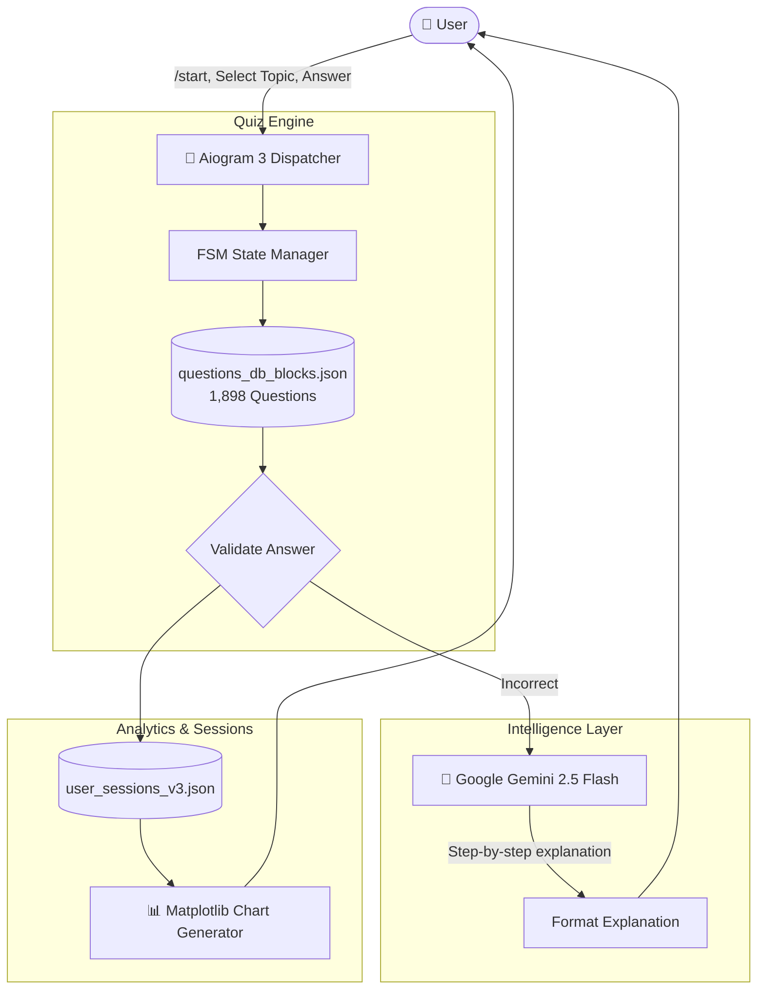

<div align="center">

# 🏛️ AI Macroeconomics & Economics Theory Bot

**Interactive EdTech Telegram Bot powered by a 1,898-question database spanning macro- and microeconomics, real-time step-by-step AI remediation with Google Gemini, and on-the-fly progress charts.**

[](https://www.python.org/)
[](https://docs.aiogram.dev/)
[](https://ai.google.dev/)
[](LICENSE)

[🇷🇺 Читать на русском](README.md) • [🇬🇧 Read in English](README.en.md)

---

</div>

## 📑 Table of Contents

1. [Project Overview & Value Proposition](#1-project-overview--value-proposition)
   * [1.1. Purpose](#11-purpose)
   * [1.2. Solved Problems](#12-solved-problems)
2. [Key Features](#2-key-features)
   * [2.1. 10 Academic Sections (1,898 Exercises)](#21-10-academic-sections-1898-exercises)
   * [2.2. Contextual AI Error Remediation (Gemini 2.5 Flash)](#22-contextual-ai-error-remediation-gemini-25-flash)
   * [2.3. Visual Analytics & Charts (Matplotlib)](#23-visual-analytics--charts-matplotlib)
   * [2.4. FSM State Management & Persistence](#24-fsm-state-management--persistence)
3. [Architecture & Workflow](#3-architecture--workflow)
   * [3.1. System Architecture](#31-system-architecture)
   * [3.2. File Hierarchy](#32-file-hierarchy)
4. [Technology Stack](#4-technology-stack)
5. [Installation & Setup](#5-installation--setup)
   * [5.1. Dependencies](#51-dependencies)
   * [5.2. Environment Configuration](#52-environment-configuration)
   * [5.3. Execution](#53-execution)
6. [Author & Contacts](#6-author--contacts)

---

## 1. Project Overview & Value Proposition

### 1.1. Purpose
**Macroeconomics & Economics Theory Bot** is an automated learning assistant designed for university exams, professional certifications, and technical interviews in corporate banking and financial markets (Fintech, CIB, Investment Banking). It covers the full undergraduate economics curriculum: from foundational supply & demand elasticity to general macroeconomic equilibrium models (AD-AS, IS-LM) and central bank monetary policy analysis.

### 1.2. Solved Problems
* **Lack of Explanation in Textbooks:** Traditional question sets merely provide an answer key without explaining the underlying economic mechanics. This bot provides comprehensive reasoning generated by Google Gemini AI.
* **Complex Multipliers & Curve Shifts:** Students often struggle with IS-LM curve shifts and multiplier formulas. The bot delivers intuitive mnemonics and memory aids alongside formal explanations.

---

## 2. Key Features

### 2.1. 10 Academic Sections (1,898 Exercises)
Structured syllabus:
1. `01. Introduction to Economics & Economic Thought` (Mercantilism, Classical, Institutionalism).
2. `02. Supply, Demand & Equilibrium` (Price/Income elasticity, consumer/producer surplus).
3. `03. Consumer Behavior` (Cardinal & Ordinal utility, indifference curves, budget lines).
4. `04. Production & Cost Theory` (TC, MC, AC, diminishing marginal returns).
5. `05. Market Structures` (Perfect competition, monopoly, oligopoly, HHI index).
6. `06. Factor Markets` (Labor supply/demand, capital markets, land rent).
7. `07. Externalities & Public Goods` (Coase theorem, Pigouvian taxes, positive/negative externalities).
8. `08. Macroeconomic Indicators & Growth` (GDP, GDP deflator, potential output, Solow growth model).
9. `09. Macroeconomic Equilibrium (AD-AS, IS-LM)` (Keynesian cross, monetary & goods market clearing).
10. `10. Inflation, Unemployment & Business Cycles` (Phillips curve, Okun's law, stagflation).

### 2.2. Contextual AI Error Remediation (Gemini 2.5 Flash)
When an incorrect answer is selected, the bot queries Google Gemini in real-time to:
1. Explain why the selected distractor is economically invalid;
2. Prove why the correct choice holds true under economic theory;
3. Formulate a concise rule of thumb or mnemonic for retention.

### 2.3. Visual Analytics & Charts (Matplotlib)
Triggered via `/stats`, the bot compiles session performance data into graphical charts:
* Accuracy percentage broken down across all 10 economic blocks;
* Accuracy trajectory over time;
* Highlighting high-priority areas that require immediate revision.

### 2.4. FSM State Management & Persistence
* Built on Aiogram Finite State Machine (FSM) to maintain stateful quizzes across user journeys.
* User progress, accuracy logs, and completed exercises are persistently stored in JSON datastores.

---

## 3. Architecture & Workflow

### 3.1. System Architecture



### 3.2. File Hierarchy

```text
02-macroeconomics-quiz-bot/
├── bot.py                     # Main bot daemon (Aiogram 3 + Gemini + Matplotlib)
├── questions_db_blocks.json   # 1,898 structured questions across 10 sections
├── block_intros_cache.json    # Cached syllabus section overviews
├── requirements.txt           # Python package requirements
├── .env.example               # Config template
├── .gitignore                 # Version control exclusions
├── README.md                  # Russian documentation
└── README.en.md               # English documentation
```

---

## 4. Technology Stack

* **Language:** `Python 3.10+`
* **Bot Framework:** `Aiogram 3.x`
* **LLM Integration:** `google-genai` (`gemini-2.5-flash`)
* **Visualization:** `Matplotlib`, `Pillow`
* **Persistence:** `JSON Datastore`, `Aiogram FSM Storage`

---

## 5. Installation & Setup

### 5.1. Dependencies
```bash
git clone https://github.com/Andrew123485/macroeconomics-quiz-bot.git
cd macroeconomics-quiz-bot

python -m venv venv
.\venv\Scripts\activate   # Windows
source venv/bin/activate  # Linux / macOS

pip install -r requirements.txt
```

### 5.2. Environment Configuration
```bash
cp .env.example .env
```
Fill in configuration keys:
```env
BOT_TOKEN=your_bot_token_from_botfather
GEMINI_API_KEY=your_google_gemini_api_key
```

### 5.3. Execution
```bash
python bot.py
```

---

## 6. Author & Contacts

* **Author:** Andrei Vladimirov
* **Specialization:** Business Analyst / Product Manager (Fintech / CIB)
* **Telegram:** [@amorfatimementomoria](https://t.me/amorfatimementomoria)
* **GitHub:** [github.com/Andrew123485](https://github.com/Andrew123485)
