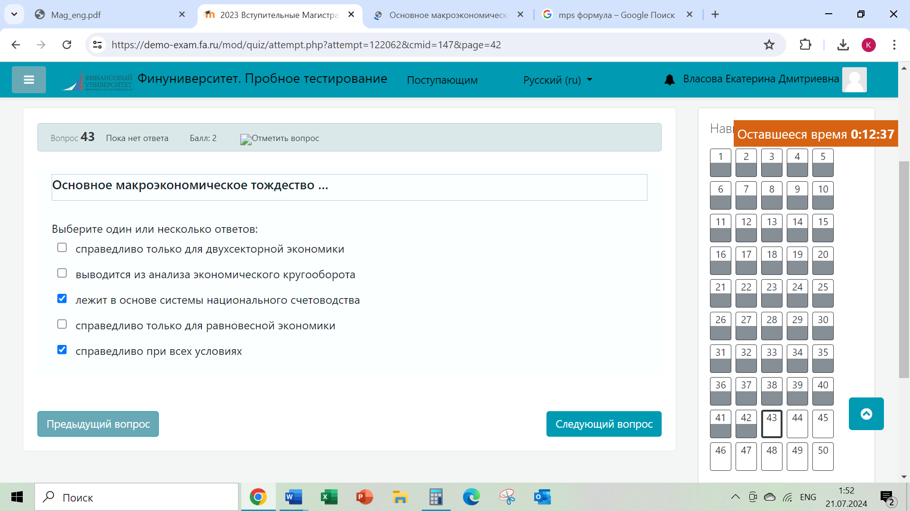
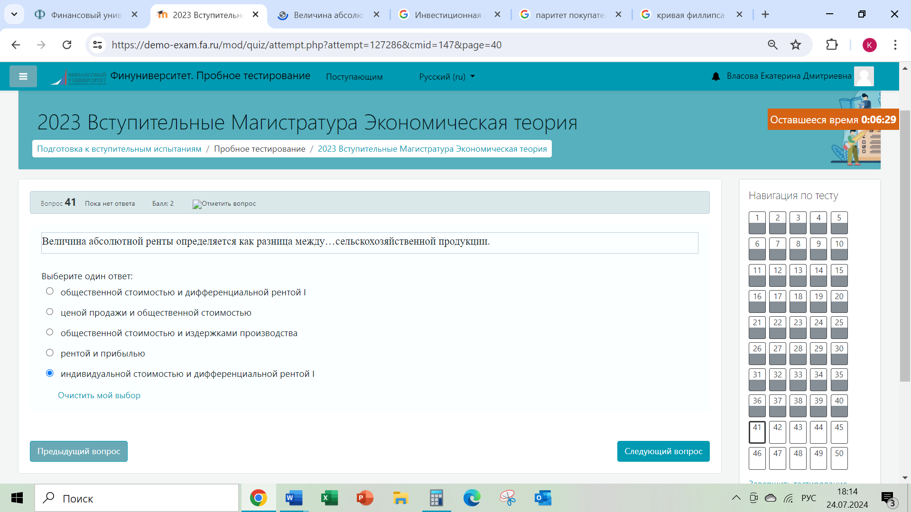
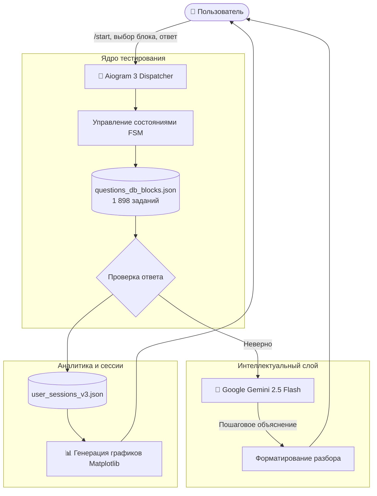

<div align="center">

# 🏛️ AI Macroeconomics & Economics Theory Bot

**Интерактивный образовательный Telegram-бот с базой из 1 898 задач по макро- и микроэкономике, адаптивной генерацией пошаговых ИИ-объяснений через Google Gemini и динамической визуализацией успеваемости.**

[](https://www.python.org/)
[](https://docs.aiogram.dev/)
[](https://ai.google.dev/)
[](LICENSE)

[🇷🇺 Читать на русском](README.md) • [🇬🇧 Read in English](README.en.md)

---

</div>

## 📑 Содержание

1. [Обзор проекта и концепция](#1-обзор-проекта-и-концепция)
   * [1.1. Назначение сервиса](#11-назначение-сервиса)
   * [1.2. Решаемые проблемы](#12-решаемые-проблемы)
2. [Ключевые возможности](#2-ключевые-возможности)
   * [2.1. 10 академических блоков экономической теории (1 898 заданий)](#21-10-академических-блоков-экономической-теории-1-898-заданий)
   * [2.2. Пошаговые ИИ-разборы ошибок (Gemini 2.5 Flash)](#22-пошаговые-ии-разборы-ошибок-gemini-25-flash)
   * [2.3. Графическая аналитика прогресса (Matplotlib)](#23-графическая-аналитика-прогресса-matplotlib)
   * [2.4. FSM-сессии и сохранение прогресса](#24-fsm-сессии-и-сохранение-прогресса)
3. [Архитектура и потоки данных](#3-архитектура-и-потоки-данных)
   * [3.1. Схема архитектуры](#31-схема-архитектуры)
   * [3.2. Файловая структура](#32-файловая-структура)
4. [Стек технологий](#4-стек-технологий)
5. [Установка и запуск](#5-установка-и-запуск)
   * [5.1. Установка зависимостей](#51-установка-зависимостей)
   * [5.2. Настройка .env](#52-настройка-env)
   * [5.3. Запуск](#53-запуск)
6. [Автор и контакты](#6-автор-и-контакты)

---

## 1. Обзор проекта и концепция

### 1.1. Назначение сервиса
**Macroeconomics & Economics Theory Bot** — специализированный цифровой тренажер для подготовки к экзаменам, тестированиям и собеседованиям в финансовом и банковском секторе (Fintech, CIB, Investment Banking). Бот охватывает весь спектр университетской программы: от базовых моделей спроса и предложения до моделей общего макроэкономического равновесия (AD-AS, IS-LM) и анализа монетарной политики регуляторов.

### 1.2. Решаемые проблемы
* **Отсутствие разборов:** В классических сборниках тестов есть только ключ ответа, но нет объяснения экономической логики. Бот не просто сообщает верный ответ, а дает глубокий контекстный разбор от Gemini AI.
* **Сложность формул и графиков:** Студентам трудно запоминать эффекты сдвигов кривых IS-LM и мультипликаторы. Бот дает ассоциативные подсказки и правила быстрого запоминания.

---

## 2. Ключевые возможности

### 2.1. 10 академических блоков экономической теории (1 898 заданий)
База структурирована по разделам:
1. `01. Введение в экономику и история учений` (меркантилизм, классическая школа, институционализм).
2. `02. Спрос, предложение и равновесие` (эластичность, излишки потребителя/производителя).
3. `03. Поведение потребителя` (кардиналистская и ординалистская теории, кривые безразличия).
4. `04. Производство и издержки` (TC, MC, AC, закон убывающей предельной отдачи).
5. `05. Рыночные структуры` (совершенная конкуренция, монополия, олигополия, индекс Херфиндаля-Хиршмана).
6. `06. Рынки факторов производства` (рынок труда, капитала, земельная рента).
7. `07. Внешние эффекты и общественные блага` (теорема Коуза, экстерналии, налоги Пигу).
8. `08. Макроэкономика: показатели и рост` (ВВП, дефлятор, потенциальный выпуск, модель Солоу).
9. `09. Макроэкономическое равновесие (AD-AS, IS-LM)` (кейнсианский крест, монетарный и товарный рынки).
10. `10. Инфляция, безработица и циклы` (кривая Филлипса, закон Оукена, стагфляция).

### 2.2. Пошаговые ИИ-разборы ошибок (Gemini 2.5 Flash)
При совершении ошибки бот в реальном времени вызывает нейросеть Google Gemini с промптом, требующим:
1. Объяснить ошибочность выбранного варианта;
2. Доказать экономическую корректность правильного ответа;
3. Сформулировать мнемоническое правило или краткую формулу для запоминания.

### 2.3. Графическая аналитика прогресса (Matplotlib)
По команде `/stats` бот собирает данные сессии и рендерит графический отчет:
* Процент правильных ответов по каждому из 10 блоков;
* График динамики правильности ответов;
* Рекомендация тем, требующих первоочередного повторения.

<div align="center">

| Пример графического задания: Моделирование кривых спроса и предложения | Пример аналитической диаграммы теории макроэкономики |
|:---:|:---:|
|  |  |

</div>

### 2.4. FSM-сессии и сохранение прогресса
* Поддержка машины состояний (Aiogram FSM) гарантирует непрерывность диалога.
* Прогресс, история решенных заданий и статистика пользователя персистентно сохраняются в JSON-хранилище сессий.

---

## 3. Архитектура и потоки данных

### 3.1. Схема архитектуры



### 3.2. Файловая структура

```text
02-macroeconomics-quiz-bot/
├── bot.py                     # Основной код бота (Aiogram 3 + Gemini + Matplotlib)
├── questions_db_blocks.json   # Структурированная база из 1 898 вопросов по 10 блокам
├── block_intros_cache.json    # Кэш вводных описаний разделов экономики
├── requirements.txt           # Зависимости Python
├── .env.example               # Шаблон файла конфигурации
├── .gitignore                 # Исключения Git
├── README.md                  # Документация на русском
└── README.en.md               # English Documentation
```

---

## 4. Стек технологий

* **Язык разработки:** `Python 3.10+`
* **Telegram Framework:** `Aiogram 3.x`
* **Нейросети:** `google-genai` (`gemini-2.5-flash`)
* **Визуализация:** `Matplotlib`, `Pillow`
* **Хранение данных:** `JSON Datastore`, `FSM Storage`

---

## 5. Установка и запуск

### 5.1. Установка зависимостей
```bash
git clone https://github.com/Andrew123485/macroeconomics-quiz-bot.git
cd macroeconomics-quiz-bot

python -m venv venv
.\venv\Scripts\activate   # Windows
source venv/bin/activate  # Linux / macOS

pip install -r requirements.txt
```

### 5.2. Настройка .env
```bash
cp .env.example .env
```
Заполните ключи:
```env
BOT_TOKEN=your_bot_token_from_botfather
GEMINI_API_KEY=your_google_gemini_api_key
```

### 5.3. Запуск
```bash
python bot.py
```

---

## 6. Автор и контакты

* **Автор:** Владимиров Андрей Георгиевич
* **Специализация:** Бизнес-аналитик / Продакт-менеджер (Финтех / КИБ)
* **Telegram:** [@amorfatimementomoria](https://t.me/amorfatimementomoria)
* **GitHub:** [github.com/Andrew123485](https://github.com/Andrew123485)
